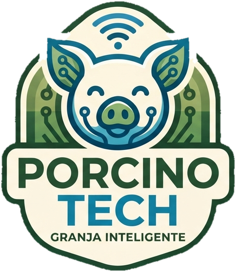

<div align="center">



# PorcinoTech 🐖🌾

**Administra tu granja porcina desde el celular: cerdos, corrales, alimento y partos, todo en un solo lugar y en tiempo real.**


[📥 Descargar APK](../../releases) · [🚜 Funciones](#-funciones) · [💻 Compilar](#-compilar-desde-el-código) · [🔒 Roles](#-permisos-por-rol)

</div>

---

PorcinoTech es una app móvil para llevar el control de una granja porcina: registra tus cerdos, organiza los corrales, calcula la ración diaria, da seguimiento a las gestaciones y consulta el clima para prevenir el estrés por calor.

Hecha con **Flutter + Supabase**. No necesita servidor propio: la app habla directo con Supabase y la seguridad la hace cumplir la base de datos (RLS).

## 📥 Instalar en tu teléfono

1. Descarga **`PorcinoTech.apk`** desde la sección [**Releases**](../../releases) de este repositorio.
2. Ábrelo en tu teléfono Android. Si te lo pide, permite **"Instalar apps desconocidas"** para el navegador o administrador de archivos que usaste.
3. Si aparece el aviso de **Play Protect**, elige **Instalar de todos modos** (la app no está en Play Store, por eso no está verificada).
4. Abre **PorcinoTech**, toca **Crear una cuenta** y elige: **crear tu granja** (administrador) o **unirte con un código** (operador).

> 📶 Necesitas conexión a internet: los usuarios de una misma granja comparten los datos en tiempo real.
> 🤖 Solo Android: en iPhone no se puede instalar un APK.

## 🚜 Funciones

- 🐽 **Cerdos:** registro, edición y archivo, con arete único y control de peso.
- 🏚️ **Corrales:** capacidad, estado y etapa productiva de cada uno.
- 🌽 **Alimentación automática:** la ración diaria se calcula sola según los cerdos y la etapa de cada corral, y el stock se descuenta al registrar consumos.
- 🍼 **Inseminaciones y partos:** próximos partos, gestaciones fallidas y partos reales con reglas de negocio.
- 📈 **Panel de inicio:** gráfica de consumo y ☀️ **clima en vivo** con alerta de estrés por calor (Open-Meteo).
- 🏡 **Multigranja:** crea todas las granjas que quieras, cada una con sus datos separados, y cambia entre ellas con un toque.
- 🔑 **Cuentas seguras:** registro con correo, contraseña con mínimo 8 caracteres (letras y números) y recuperación con código de 6 dígitos, sin salir de la app.
- ☁️ **Todo en la nube:** si desinstalas la app, inicias sesión y recuperas tus datos.
- 🔄 **Tiempo real:** los cambios de un compañero se ven al instante en la misma granja.

## 🧩 Arquitectura

| Pieza | Servicio |
|---|---|
| Registro e inicio de sesión | Supabase Auth |
| Datos (cerdos, corrales, alimentos, partos) | Supabase REST (PostgREST) con reglas RLS |
| Cambios en vivo entre usuarios | Supabase Realtime |
| Clima y geocodificación (sin clave) | Open-Meteo |
| Inicio de sesión con Google | Pendiente |

```
lib/
├── main.dart                 Arranque de la app
├── core/
│   ├── config/               Conexión (app_config.dart)
│   ├── router/               Rutas (go_router)
│   ├── supabase/             Cliente de Supabase
│   └── widgets/              Layout principal
└── features/
    ├── auth/                 Login, registro y recuperar contraseña
    ├── farms/                Crear/unirse a granja y cambiar de granja
    ├── dashboard/            Inicio: consumo y clima
    ├── cerdos/               Registro de cerdos y reglas
    ├── corrales/             Corrales
    ├── alimentos/            Alimentos, etapas y plan de alimentación
    ├── partos/               Inseminaciones y partos
    └── profile/              Datos personales y equipo de la granja
assets/images/                Logo e ícono de la app
supabase/                     Esquema SQL, migraciones y plantilla de correo
.github/workflows/            Publicación automática del APK
```

## 🧑‍🌾 Cómo funcionan las cuentas y las granjas

- **Registro:** solo correo, nombre y contraseña. Todo queda en la nube ligado a tu cuenta.
- **Crear una granja** → eres **administrador**. Puedes tener varias y cambiar entre ellas con el botón de la granja en la barra superior.
- **Unirte con un código** → eres **operador**. El administrador ve el código en **Perfil > Mi granja** y se lo comparte.
- **Datos separados:** cada granja solo ve sus propios cerdos, corrales, alimentos, consumos y partos.
- **Equipo:** en **Perfil** cada persona captura nombre, teléfono y puesto; el administrador ve al **Equipo de la granja** y puede quitar operadores.
- La app ya trae su conexión (solo la clave pública, protegida por RLS), así que quien descargue el APK solo inicia sesión.

## 🌽 Alimentación

Cada corral tiene una etapa productiva (**Pre-inicio, Inicio, Desarrollo, Engorda, Gestación, Lactancia**) con una ración sugerida. La ración diaria se calcula sola:

`cerdos activos del corral × ración de su etapa`

Un alimento puede asignarse a una etapa (solo cuenta los corrales de esa etapa) o a todas. Al registrar un consumo, el trigger resta la cantidad del stock y rechaza consumos mayores que la existencia.

## 📋 Reglas de negocio

La base de datos las hace cumplir (la app solo avisa antes):

- Una cerda tiene una sola gestación en curso. Si no llega a parir, se marca como **fallida** desde *Próximos partos* y queda libre para una nueva inseminación.
- Solo una hembra activa puede inseminarse, y no antes de su nacimiento.
- El parto real no puede registrarse antes de 100 días de la monta ni en el futuro.
- Una cerda con gestación en curso no puede cambiar de sexo ni pasar a vendida, fallecida o baja.
- Un corral no admite más cerdos activos que su capacidad.
- El peso va de 0 a 500 kg.

## 🔒 Permisos por rol

Todos los integrantes de una misma granja ven los mismos datos; otra granja no. El rol (administrador/operador) es **por granja**.

| Acción | Administrador | Operador |
|---|:---:|:---:|
| Cerdos: ver, registrar, editar | ✅ | ✅ |
| Cerdos: eliminar (o archivar si tiene partos) | ✅ | ❌ |
| Corrales: ver y cambiar estado | ✅ | ✅ |
| Corrales: crear, editar datos, eliminar | ✅ | ❌ |
| Alimentos: ver y registrar consumo | ✅ | ✅ |
| Alimentos: crear, editar stock, eliminar | ✅ | ❌ |
| Inseminaciones y partos reales: registrar | ✅ | ✅ |
| Partos: eliminar | ✅ | ❌ |
| Etapas productivas: modificar | ❌ (catálogo común) | ❌ |
| Ver el código de granja e invitar operadores | ✅ | ❌ |
| Cambiar roles | Solo desde SQL Editor | ❌ |

## 💻 Compilar desde el código

**Requisitos:** [Flutter](https://docs.flutter.dev/get-started/install) y una cuenta gratuita en [Supabase](https://supabase.com) (solo si montas tu propio servidor).

```powershell
flutter pub get
flutter run -d chrome
```

Opcionalmente puedes dar un valor inicial de conexión con `env.json` (copia `env.example.json`; no se sube al repositorio):

```powershell
flutter run -d chrome --dart-define-from-file=env.json
flutter build apk --release
```

El APK queda en `build/app/outputs/flutter-apk/app-release.apk`.

### 🗃️ Montar tu propio servidor (opcional)

1. Crea un proyecto gratuito en [supabase.com](https://supabase.com).
2. En **SQL Editor** pega y ejecuta todo `supabase/setup_completo.sql` (en un proyecto nuevo y vacío: crea tablas, reglas y permisos).
3. En **Authentication > Providers > Email** deja habilitado Email. Para pruebas puedes desactivar **Confirm email**; en producción configura SMTP.
4. En **Project Settings > API** copia la **Project URL** y la clave **publishable** (anon). ⚠️ Nunca uses `service_role` / `sb_secret_`: la app la rechaza.
5. Pon esos datos en `lib/core/config/app_config.dart` o compílala con `--dart-define-from-file=env.json`.

> ¿Ya tenías un proyecto con las migraciones anteriores? **No** vuelvas a ejecutar `setup_completo.sql`. Para separar las granjas ejecuta, en este orden, `supabase/respaldo_antes_de_20261003.sql` (copia de seguridad en el esquema `respaldo_20261020`) y `supabase/migrations/20261003_multi_granja.sql`. Tus datos quedan juntos en la «Granja principal» y las cuentas conservan su rol.

### 📧 Correo de recuperación de contraseña (una vez, en Supabase)

1. **Authentication > Emails > Templates > Reset Password**: reemplaza el contenido por algo como `<h2>Recupera tu contraseña</h2><p>Tu código es: <b>{{ .Token }}</b></p>` (hay una plantilla lista en `supabase/plantilla_correo_recuperar.html`).
2. **Authentication > Sign In / Providers > Email**: sube «Minimum password length» a 8 y activa «Leaked password protection» si tu plan lo permite.
3. El correo de pruebas de Supabase tiene pocos mensajes por hora. Para uso real configura un SMTP propio en **Authentication > SMTP Settings**.

## 📦 Publicar el APK en GitHub Releases

La app usa el identificador `mx.utvm.porcinotech` (se cambia en `android/app/build.gradle.kts`, línea `applicationId`; cámbialo **antes** de la primera publicación, porque después Android lo trata como otra app).

1. **Llave de firma** (una sola vez; guárdala, sin ella no podrás actualizar la app):
   ```powershell
   keytool -genkey -v -keystore porcinotech.jks -keyalg RSA -keysize 2048 -validity 10000 -alias porcinotech
   ```
2. **Automático con GitHub:** en *Settings > Secrets and variables > Actions* crea `ANDROID_KEYSTORE_BASE64` (el `.jks` en base64: `[Convert]::ToBase64String([IO.File]::ReadAllBytes("porcinotech.jks"))`), `ANDROID_KEYSTORE_PASSWORD`, `ANDROID_KEY_ALIAS` y `ANDROID_KEY_PASSWORD`. Luego sube una etiqueta:
   ```powershell
   git tag v1.0.0
   git push origin v1.0.0
   ```
   El flujo `.github/workflows/release.yml` construye el APK y lo adjunta al Release como `PorcinoTech.apk`.
3. **A mano:** crea `android/key.properties` con `storeFile`, `storePassword`, `keyAlias` y `keyPassword` y ejecuta `flutter build apk --release`.

---

<div align="center">

Proyecto individual para la materia **Desarrollo Móvil Integral** · Universidad Tecnológica del Valle del Mezquital (UTVM) 🎓

Hecho con 🌱 por [Angel Jovani Benitez Mezquite](https://github.com/angel04-gifd)

</div>
